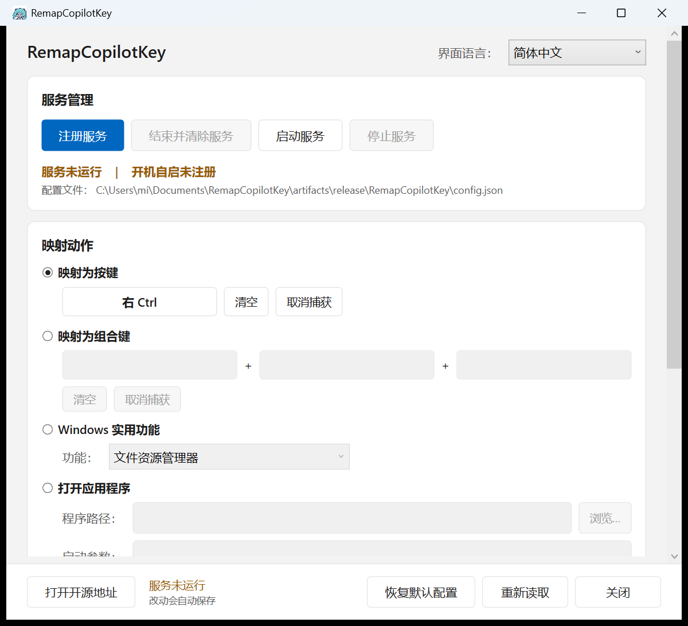
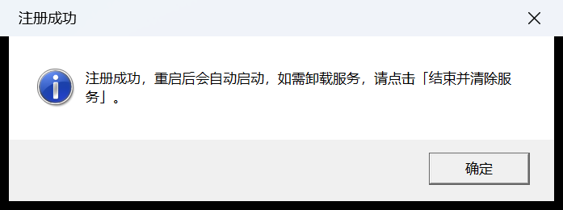
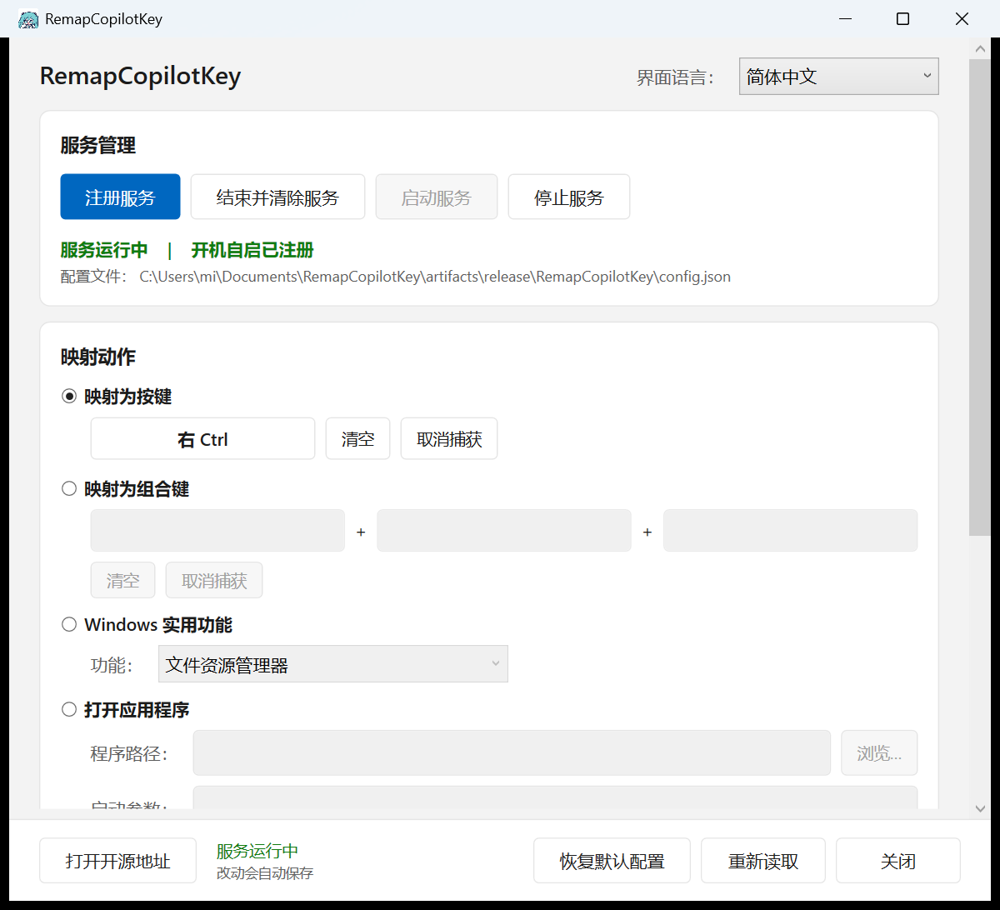

<p align="center">
  
</p>

<p align="center">
  <a href="README.md">中文</a> | <strong>English</strong>
</p>

<p align="center">
  <a href="https://github.com/Anlerway/RemapCopilotKey/releases/latest"></a>
  <a href="https://github.com/Anlerway/RemapCopilotKey/stargazers"></a>
  
  <a href="LICENSE"></a>
</p>

# RemapCopilotKey

Give the **Copilot key** on your laptop back to the **right Ctrl** — or turn it into any key, hotkey, app launch, URL, or Windows utility.

No firmware flashing, no `Scancode Map` edits, no kernel drivers: a single user-mode low-level keyboard hook does **three-key sequence detection**, and the whole configuration is one JSON file.

**Who it is for**: anyone whose keyboard has a Copilot key and who wants the right Ctrl back. Microsoft tells OEMs with no spare key to replace right Ctrl with the Copilot key — there is no BIOS or Windows setting to undo it — and the Copilot key actually reports `Left Win + Left Shift + F23` in firmware, so any "remap F23 only" trick still leaves `Win + Shift` behind.

- Five targets: a key (held while you hold Copilot), a three-key chord, an app, a URL, or one of 14 Windows utilities
- **Sequence-only triggering**: pressing Win alone, Shift alone, `Win+E` or `Win+Shift+S` keeps working exactly as before
- Takes effect immediately: the service polls the config every 2 s; the UI has **no Save button** — it writes 600 ms after you stop typing
- Auto-start = a LocalSystem service that delivers the hook process into your session; the hook runs at **high integrity (0x3000)** with **no UAC prompt, ever**
- Zero external dependencies: hand-written JSON parser, WPF on .NET Framework 4.8 (built into Windows 10 1903+), release package under 0.5 MB

## Screenshots

<p align="center">
  
</p>

<p align="center"><em>Main window: Register service is the primary button, there is no Save button, the bottom line is the save status</em></p>

After "Register service" succeeds:

<p align="center">
  
</p>

The status bar turns green once the hook has been delivered into your session:

<p align="center">
  
</p>

## Install

### Quick start (recommended)

1. Download `RemapCopilotKey-v1.0.0-x64.zip` from [Releases](https://github.com/Anlerway/RemapCopilotKey/releases) (or build it yourself with `package.cmd`)
2. Extract into **one folder**, e.g. `C:\Program Files\RemapCopilotKey\`

   > Both executables must sit together: each of them reads and writes the `config.json` **in its own folder**.

3. Run `RemapCopilotKey.exe` (one UAC prompt), pick your mapping — it saves automatically
4. Click "**Register service**": it registers a LocalSystem auto-start service and starts it. From then on every boot delivers the hook into your session with **no UAC prompting**

### Update

Just replace the executables; your `config.json` is untouched. Stop the service first, replace, then start it again.

### Uninstall

Click "**Stop and remove**": stop the service → delete the SCM registration → wait until the service name is gone → clean up the legacy scheduled task. The Copilot key goes back to stock behaviour; then delete the folder.

Manual cleanup:

```bat
sc stop RemapCopilotKeyAgent
sc delete RemapCopilotKeyAgent
schtasks /Delete /TN RemapCopilotKey /F
```

### Build from source

Requirements: Visual Studio (MSVC + .NET Framework 4.8 Targeting Pack) and the Windows SDK. No .NET SDK, no NuGet packages.

```bat
build.cmd               :: build + run every test
build.cmd test          :: tests only
package.cmd             :: portable release + SHA256SUMS.txt
```

## Features

| Task | How |
| --- | --- |
| Map to a key | Held while Copilot is held, released together; defaults to right Ctrl |
| Map to a chord | One press sends up to three keys, e.g. `Ctrl + Shift + Esc` |
| Open an app | exe, shortcut or script, with optional arguments and optional elevation |
| Open a URL | Handed to the default browser |
| Windows utilities | Explorer, Task Manager, cmd, PowerShell, screenshot, Snipping Tool, Settings, Control Panel, Calculator, Notepad, Task View, clipboard history, emoji panel, lock screen (pressing again closes what it started) |
| Record a hotkey | Click the box and press the keys; left/right modifiers are distinguished, Win can be recorded too (the Start menu still pops up while recording) |
| Auto-save | Writes 600 ms after the last change and tells the service to reload; invalid input is reported, never written |
| Restore defaults | "Restore defaults" at the bottom resets everything and saves immediately |
| Service management | Register / stop and remove / start / stop; button states follow the real state |
| Localization | Chinese and English packs; drop a JSON into `Lang\` to add a language (tests assert identical key sets) |

## Configuration

`config.json` (UTF-8, no BOM) in the program folder. The service re-reads it every 2 s, so a save is live almost instantly:

```json
{
  "version": 1,
  "language": "zh-CN",
  "logLevel": "error",
  "enabled": true,
  "mapping": {
    "trigger": "copilotKey",
    "reloadOnChange": true,
    "action": { "type": "sendKey", "vkey": "VK_RCONTROL" }
  }
}
```

| Field | Default | Meaning |
| --- | --- | --- |
| `language` | `"zh-CN"` | UI language, matches a pack in `Lang\` |
| `logLevel` | `"error"` | `off` / `error` / `warn` / `info` / `debug`; switch to `debug` when troubleshooting |
| `enabled` | `true` | Master switch; the hook stays installed but stops intercepting |
| `mapping.trigger` | `"copilotKey"` | The only trigger for now |
| `mapping.reloadOnChange` | `true` | Reload when the file changes |
| `mapping.action` | `sendKey` → `VK_RCONTROL` | See the five forms below |

| Action | Form |
| --- | --- |
| Key | `{ "type": "sendKey", "vkey": "VK_RCONTROL" }` |
| Chord | `{ "type": "sendChord", "keys": ["VK_CONTROL", "VK_SHIFT", "VK_ESCAPE"] }` |
| App | `{ "type": "openApp", "path": "C:\\Windows\\System32\\notepad.exe", "args": "" }` |
| URL | `{ "type": "openUrl", "url": "https://github.com/Anlerway/RemapCopilotKey" }` |
| Utility | `{ "type": "systemAction", "action": "taskManager" }` |

Key names start with `VK_`; the prefix is optional and aliases exist (`RCONTROL`, `CTRL`, `ESC`, `ENTER` …).
The full list of 147 keys is in the [design notes](docs/设计说明.md#按键名清单).

**A typo will not stop the service**: the offending field falls back to its default and a warning is logged.

## Command line

Service:

| Flag | Meaning |
| --- | --- |
| (none) / `--run` | Run as the hook (silent, no window, no tray icon) |
| `--service` | Service-host mode, for the SCM only; running it by hand exits because "it was not started by the service controller" |
| `--stop` | Stop the running instance |
| `--config <path>` | Use a specific config file |
| `--loglevel <level>` | Override the log level |
| `--quiet` / `--help` | No dialogs / usage |

Configurator: `--register-service`, `--unregister-service` (for deployment scripts), `--dump-default-config <path>`, `--diagnose`.

## How auto-start works

In one sentence: **a LocalSystem auto-start Windows service that delivers the hook process into your interactive session.**

- The service host in Session 0 calls `WTSQueryUserToken` + `DuplicateTokenEx` (then the linked elevated token) to get your token,
  and `CreateProcessAsUserW(winsta0\default)` to launch the `--run` hook inside your session;
- The hook runs at **high integrity (0x3000)** and **never goes through UAC**; it lives in your session and installs the keyboard hook;
- To check it worked, look at one line: `RemapCopilotKey.boot.log` must show `完整性=高(0x3000)` (integrity = high) and a non-zero session for the hook process.

Why not a scheduled task, and why the hook cannot be a service itself: see [design notes §8](docs/设计说明.md#8-提权与开机自启) (Chinese).

## Documentation

- [Design notes](docs/设计说明.md) (Chinese): architecture, sequence state machine, elevation and delivery, UI trade-offs
- [Config file format](docs/设计说明.md#15-附录配置文件格式) · [Command line](docs/设计说明.md#16-附录命令行参数) · [Key name list](docs/设计说明.md#按键名清单)
- [Screenshots](docs/images/)

## Development and tests

```bat
build.cmd test
```

| Suite | Assertions | Covers |
| --- | --- | --- |
| `ConfigContractTests` (C#) | 126 | Field names, round-tripping, validation, key table, complete language packs, the bundled JSON layer |
| `json_test` (C++) | 68 | Parser syntax, escapes, UTF-8, surrogate pairs, error positions |
| `config_test` (C++) | 164 | Key round-trip, parsing, every action, fallbacks, plus a field-by-field check of the config written by the C# side |

The C# → C++ contract is the most fragile part of this project (one renamed field breaks everything), so it is verified across languages.

A few traps worth remembering:

1. `.cmd` / `.bat` must be pure ASCII with CRLF — `cmd.exe` parses batch files in the OEM code page;
2. `.ps1` files must have a UTF-8 BOM — PowerShell 5.1 otherwise decodes them as GBK and reports `Missing closing '}'`;
3. The C++ linker needs `/MANIFESTUAC:NO`, otherwise `app.manifest` clashes with MSVC's default fragment and `mt.exe` fails with `c1010001`;
4. Windows headers do not define `VK_A`..`VK_Z`; letter virtual-key codes are their uppercase ASCII values;
5. C++ / C# / `.xaml` sources are UTF-8 without BOM, and C++ is compiled with `/utf-8`.

## Known limitations

- **Secure desktop is out of reach**: Ctrl+Alt+Del, UAC prompts and the lock screen are invisible to a user-mode hook.
- **The hook must run in an interactive session**: only the service host can live in Session 0, and it does not install the hook.
- **When not elevated**, keys sent to elevated windows cannot be intercepted (a warning is logged at startup).
- **The sequence window is 100 ms**: on a very slow Bluetooth keyboard the three keys may be treated as a manual Win + Shift press.
- **Keyboard hooks are chained**: with several low-level hooks installed, the newest one sees keys first; restart the service to get back in front.
- 64-bit Windows 10 / 11 only.

## Troubleshooting

Start with the two logs in the program folder: `RemapCopilotKey.boot.log` (startup trace, **independent of `logLevel`**) and `RemapCopilotKeyService.log` (normal log, `error` only by default).

| Symptom | What to check |
| --- | --- |
| Nothing happens on the Copilot key | Is `enabled` `true`? Does `boot.log` say `完整性=高(0x3000)`? Set `logLevel` to `debug` and watch the key stream |
| I get `Win+Shift+…` instead | The sequence never completed: keys more than 100 ms apart (Bluetooth), or another hook got in first |
| Ctrl gets stuck down | Usually after switching to an elevated window; make sure the service runs elevated, or restart it to re-hook |
| Config changes do nothing | Are both executables in the same folder? Does the bottom line say "saved"? For hand edits use "Reload" |
| Works after login, not after reboot | Check the `完整性` and session of the hook line in `boot.log`; if wrong, "Stop and remove" then "Register service" again |
| "Register service" says access denied | Run the configurator elevated — `CreateService` needs admin rights (error 5) |

## Issues

Bug reports and new mapping actions are welcome:
<https://github.com/Anlerway/RemapCopilotKey/issues>

## About "Unknown publisher"

Nothing here is code-signed, and both executables are `requireAdministrator`, so the UAC prompt shows "Unknown publisher" when you **double-click** them or **register the service the first time**.
Auto-start bypasses UAC entirely and never shows it. Removing it for good requires a certificate from a trusted CA (self-signed certificates only work on machines that installed them, so this repository ships no signing script).

## License

AGPL-3.0, see [LICENSE](LICENSE).
