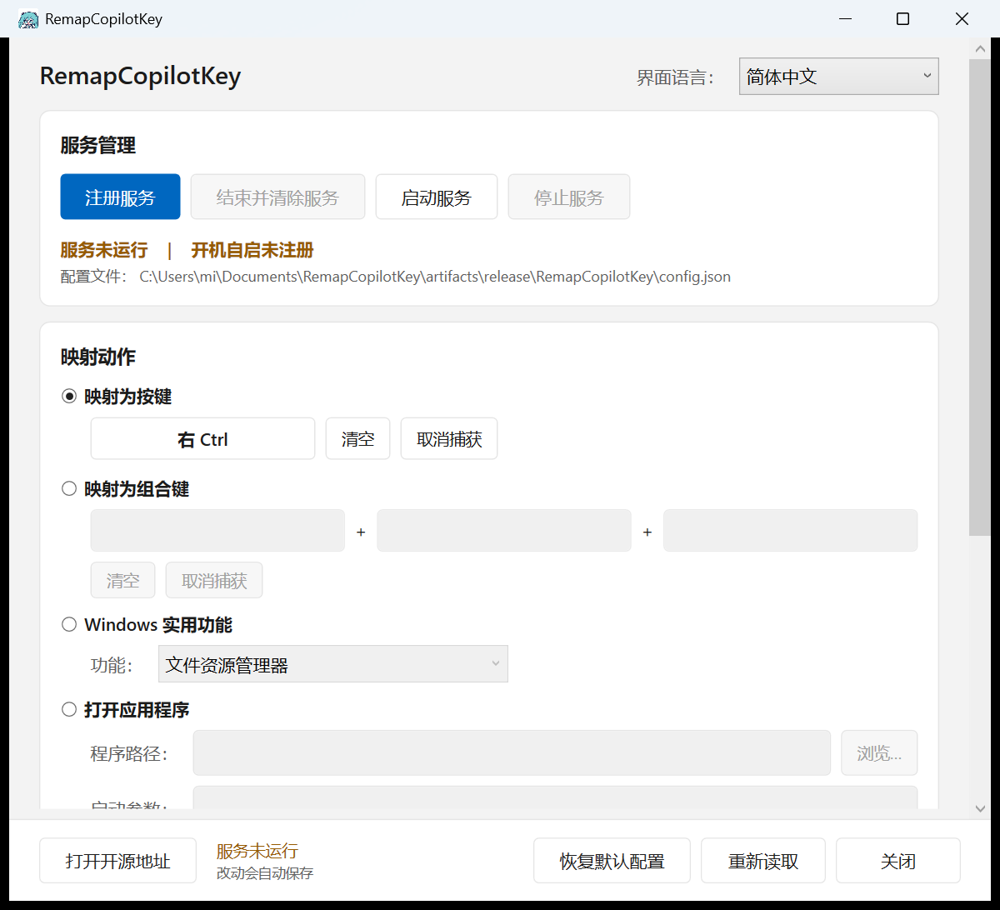
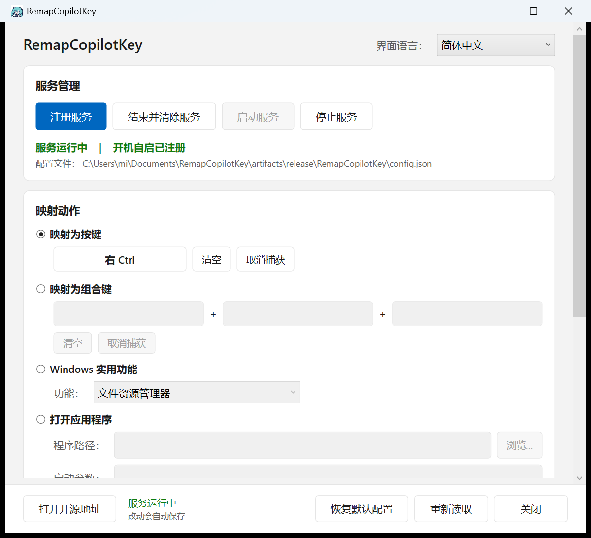

<p align="center">
  
</p>

<p align="center">
  <a href="README.md">中文</a> | <strong>English</strong>
</p>

<p align="center">
  <a href="https://github.com/Anlerway/RemapCopilotKey/releases/latest"></a>
  <a href="https://github.com/Anlerway/RemapCopilotKey/stargazers"></a>
  
  <a href="LICENSE"></a>
</p>

# RemapCopilotKey

Turn the **Copilot key** on your laptop into the key you actually want — right Ctrl by default, or any key, hotkey, app, URL or Windows utility.

No BIOS flashing, no registry hacks, no drivers: the app recognises the **three-key sequence** the Copilot key reports in firmware, so pressing Win alone or `Win+E` still works exactly as before.

## Getting started

1. Download `RemapCopilotKey-v1.1.0-x64.zip` from [Releases](https://github.com/Anlerway/RemapCopilotKey/releases) and extract it into **one folder** (e.g. `C:\Program Files\RemapCopilotKey\`).
   Both executables must sit together — each reads the `config.json` in its own folder.
2. Run `RemapCopilotKey.exe` (one UAC prompt) and pick what the Copilot key should do. It saves 600 ms after you stop — there is no Save button.
3. Click "**Register service**". From then on it starts with every boot and **never prompts for UAC again**.
4. To undo everything, click "**Stop and remove**" and delete the folder; the Copilot key behaves as shipped again.

<p align="center">
  
</p>

<p align="center"><em>Main window: Register service is the primary button, there is no Save button, the bottom line is the save status</em></p>

After registering, the status bar turns green and the hook has been delivered into your session:

<p align="center">
  
</p>

**Updating**: "Stop service", replace the executables, "Start service". Your `config.json` is untouched.

**Manual uninstall** (if the UI is unavailable):

```bat
sc stop RemapCopilotKeyAgent
sc delete RemapCopilotKeyAgent
schtasks /Delete /TN RemapCopilotKey /F
```

## What you can map it to

| Target | Behaviour |
| --- | --- |
| A key | Held while you hold Copilot, released together; right Ctrl by default |
| A chord | One three-key chord per press, e.g. `Ctrl + Shift + Esc` |
| An app | Any exe / shortcut / script, optional arguments, optional "run as admin" |
| A URL | Opens in your default browser |
| A Windows utility | Explorer, Task Manager, cmd, PowerShell, Snipping Tool, Settings, Calculator … 14 in total |

Other things in the window:

- **Record a shortcut**: click the box and press the keys; left/right modifiers are distinguished and Win can be recorded
- **Auto-save**: writes 600 ms after you stop and tells the service to reload; invalid input only shows a hint, nothing is written
- **Restore defaults**: one click at the bottom
- **Service management**: register / stop and remove / start / stop — buttons follow the real state
- **Localisation**: drop a JSON into `Lang\` to add a language

## Configuration file

`config.json` (UTF-8, no BOM) sits next to the executables. The service checks it every 2 s, so saving is enough:

```json
{
  "version": 1,
  "language": "en-US",
  "logLevel": "error",
  "enabled": true,
  "mapping": {
    "trigger": "copilotKey",
    "reloadOnChange": true,
    "action": { "type": "sendKey", "vkey": "VK_RCONTROL" }
  }
}
```

| Field | Default | Meaning |
| --- | --- | --- |
| `language` | `"zh-CN"` | UI language, matches a pack under `Lang\` |
| `logLevel` | `"error"` | `off` / `error` / `warn` / `info` / `debug` — set `debug` when troubleshooting |
| `enabled` | `true` | Master switch; the hook stays installed but stops intercepting |
| `mapping.trigger` | `"copilotKey"` | The only trigger for now |
| `mapping.reloadOnChange` | `true` | Reload when the file changes |
| `mapping.action` | `sendKey` → `VK_RCONTROL` | The five action shapes below |

| Action | Shape |
| --- | --- |
| A key | `{ "type": "sendKey", "vkey": "VK_RCONTROL" }` |
| A chord | `{ "type": "sendChord", "keys": ["VK_CONTROL", "VK_SHIFT", "VK_ESCAPE"] }` |
| An app | `{ "type": "openApp", "path": "C:\\Windows\\System32\\notepad.exe", "args": "" }` |
| A URL | `{ "type": "openUrl", "url": "https://github.com/Anlerway/RemapCopilotKey" }` |
| A utility | `{ "type": "systemAction", "action": "taskManager" }` |

Key names start with `VK_`; the prefix is optional and aliases work (`RCONTROL`, `CTRL`, `ESC`, `ENTER` …).
The full list of 147 names is in the [design notes](docs/设计说明.md#按键名清单).

A typo cannot stop the service from starting: the offending entry falls back to its default and a warning is logged.

## Command line

Service executable:

| Argument | Meaning |
| --- | --- |
| (none) / `--run` | Hook mode (silent background process, no tray, no window) |
| `--service` | Service host mode, for the SCM only; fails fast when started by hand |
| `--stop` | Stop the running instance |
| `--config <path>` | Use a specific config file |
| `--loglevel <level>` | Override the log level for this run |
| `--quiet` / `--help` | No dialogs / print usage |

Configurator: `--register-service`, `--unregister-service`, `--dump-default-config <path>`, `--diagnose`.

## How it works

Three sentences:

1. The Copilot key actually reports `Left Win + Left Shift + F23` in firmware, so the app matches that **three-key sequence** instead of a scancode. Any Win or Shift outside the sequence passes through untouched.
2. Only an **isolated left Win** is taken — no other key may be down when it arrives. Vendor Fn hotkeys (say Fn+F5 = `Ctrl+Win+F24`) hold Ctrl first and then send Win, so they pass through and the touchpad toggle keeps working.
3. Auto-start is a LocalSystem service: it grabs your token with `WTSQueryUserToken` in Session 0 and launches the hook into your desktop with `CreateProcessAsUserW`. The hook runs at high integrity (`0x3000`) and never triggers UAC.

Deeper detail (state machine, why not a scheduled task, why no `SendInput` inside the callback) is in the [design notes](docs/设计说明.md).

## Known limitations

- **Secure desktop is out of reach**: Ctrl+Alt+Del, UAC prompts and the lock screen are invisible to a user-mode hook.
- **The hook must run in an interactive session**: only the service host can live in Session 0, and it does not install the hook.
- **When not elevated**, keys sent to elevated windows cannot be intercepted (a warning is logged at startup).
- **The sequence window is 100 ms**: on a very slow Bluetooth keyboard the three keys may be treated as a manual Win + Shift press.
- **No mapping while other keys are held**: pressing Copilot while holding Ctrl / Shift / Alt does nothing. That trade-off is what keeps vendor Fn hotkeys alive.
- **Keyboard hooks are chained**: with several low-level hooks installed, the newest one sees keys first; restart the service to get back in front.
- 64-bit Windows 10 / 11 only.

## Troubleshooting

Start with the two logs in the program folder: `RemapCopilotKey.boot.log` (startup, hook, integrity — check this for auto-start trouble) and `RemapCopilotKeyService.log` (normal log, `error` only by default — check this for key trouble).

| Symptom | What to check |
| --- | --- |
| Nothing happens on the Copilot key | Is `enabled` `true`? Does `boot.log` say `完整性=高(0x3000)`? Set `logLevel` to `debug` and watch the key stream |
| I get `Win+Shift+…` instead | The sequence never completed: keys more than 100 ms apart (Bluetooth), or another hook got in first |
| A laptop Fn hotkey stopped working (touchpad toggle, etc.) | Fixed in 1.1.0: only an isolated left Win is taken now. With `logLevel` at `debug`, a normal Fn press should no longer log "补发被拦截的按键" |
| Ctrl gets stuck down | Usually after switching to an elevated window; make sure the service runs elevated, or restart it to re-hook |
| Config changes do nothing | Are both executables in the same folder? Does the bottom line say "saved"? For hand edits use "Reload" |
| Works after login, not after reboot | Check the `完整性` and session of the hook line in `boot.log`; if wrong, "Stop and remove" then "Register service" again |
| Registering says access denied | Run the configurator as administrator (the SCM needs it — error 5) |

## Build from source

```bat
build.cmd        :: build + run every test
build.cmd test   :: tests only
package.cmd      :: portable release + SHA256SUMS.txt
```

You need Visual Studio (MSVC + .NET Framework 4.8 Targeting Pack) and the Windows SDK. No .NET SDK, no NuGet packages.

Tests: 126 C# contract assertions, 68 in `json_test`, 164 in `config_test`. The C# → C++ contract is the fragile part (one renamed field breaks everything), so it is verified end to end.

Gotchas when editing:

- `.cmd` / `.bat` must stay pure ASCII + CRLF — `cmd.exe` parses batches in the OEM codepage and Chinese comments eat structural characters;
- `.ps1` must keep its UTF-8 BOM — PowerShell 5.1 decodes as GBK and fails with `Missing closing '}'`;
- the C++ linker needs `/MANIFESTUAC:NO`, otherwise the bundled `app.manifest` clashes with the MSVC default UAC fragment and `mt.exe` fails with `c1010001`;
- C++ / C# / `.xaml` sources are UTF-8 without BOM; C++ is compiled with `/utf-8`.

## Issues

Bug reports and new mapping ideas are welcome: <https://github.com/Anlerway/RemapCopilotKey/issues>

## About "Unknown publisher"

The build is not code-signed and both executables are `requireAdministrator`, so UAC shows "Unknown publisher" when you double-click one or register the service for the first time. Auto-start never goes through UAC, so you will not see it there.

Removing it for good requires a code-signing certificate from a trusted CA (self-signed certificates are useless on other machines, so the repo ships no signing script).

## License

AGPL-3.0, see [LICENSE](LICENSE).