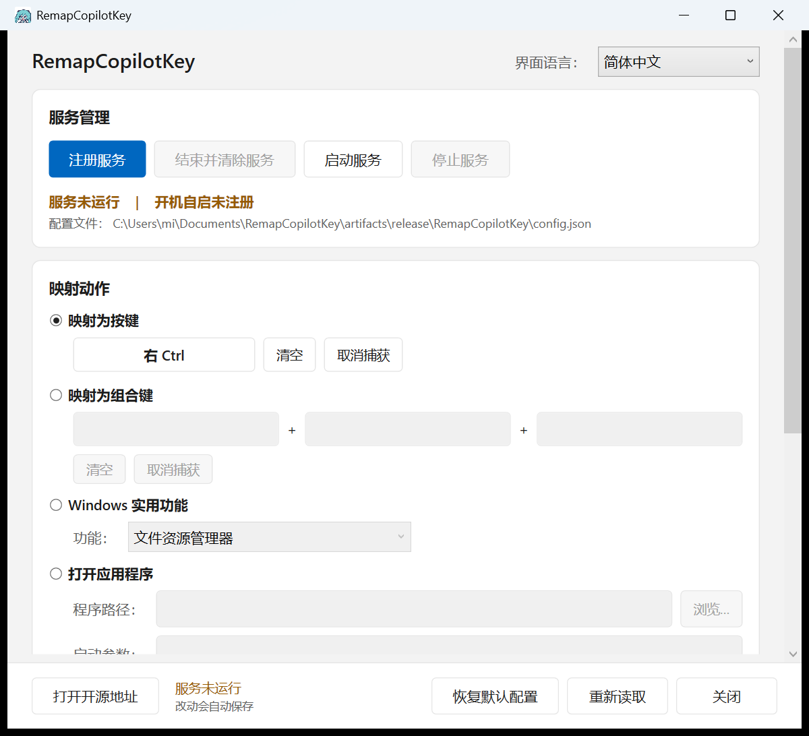
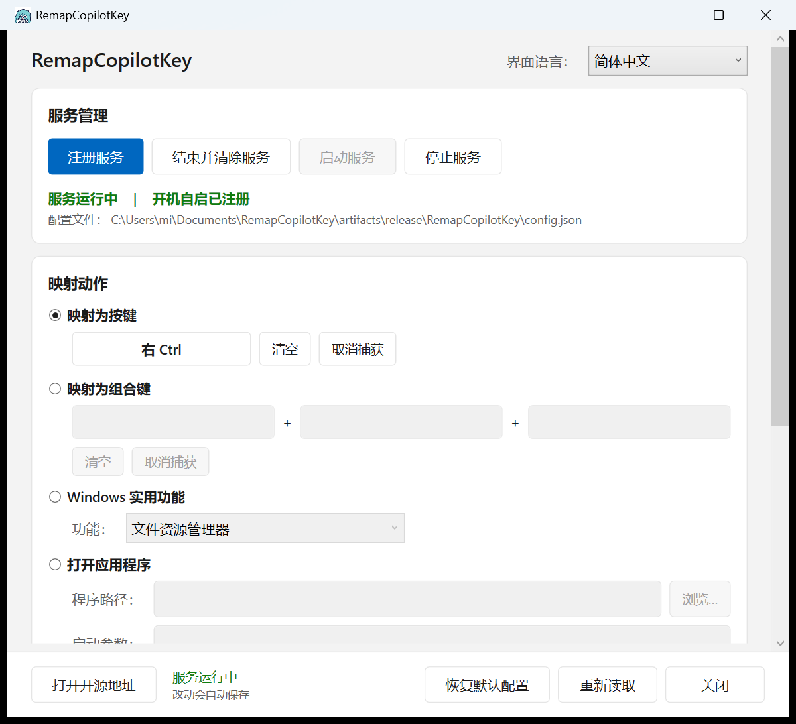

<p align="center">
  
</p>

<p align="center">
  <strong>中文</strong> | <a href="README.en.md">English</a>
</p>

<p align="center">
  <a href="https://github.com/Anlerway/RemapCopilotKey/releases/latest"></a>
  <a href="https://github.com/Anlerway/RemapCopilotKey/stargazers"></a>
  
  <a href="LICENSE"></a>
</p>

# RemapCopilotKey

把笔记本上的 **Copilot 键**改成你想要的键 —— 默认改成右 Ctrl，也可以改成任意按键、组合键、打开程序、打开网页或系统功能。

不刷 BIOS、不改注册表、不装驱动：程序认得是 Copilot 键在固件里发出的**三键序列**，所以单独按 Win、`Win+E` 这些都不受影响。

## 开始使用

1. 从 [Releases](https://github.com/Anlerway/RemapCopilotKey/releases) 下载 `RemapCopilotKey-v1.1.0-x64.zip`，解压到**同一个目录**（例如 `C:\Program Files\RemapCopilotKey\`）。
   两个 exe 必须放在一起，它们各自读写同目录下的 `config.json`。
2. 双击 `RemapCopilotKey.exe`（会弹一次 UAC），选好 Copilot 键要变成什么 —— 停手 600 ms 自动保存，没有保存按钮。
3. 点「**注册服务**」。之后每次开机自动生效，**不再弹 UAC**。
4. 想还原就点「**结束并清除服务**」，然后删掉目录，Copilot 键恢复原始行为。

<p align="center">
  
</p>

<p align="center"><em>主界面：注册服务是主按钮，没有保存按钮，底部那行就是保存状态</em></p>

注册成功后顶部状态条变绿，钩子进程已经被投递进当前会话：

<p align="center">
  
</p>

**更新**：先「停止服务」，覆盖 exe，再「启动服务」。配置在 `config.json` 里，不会丢。

**手动卸载**（界面用不了时）：

```bat
sc stop RemapCopilotKeyAgent
sc delete RemapCopilotKeyAgent
schtasks /Delete /TN RemapCopilotKey /F
```

## 能改成什么

| 类型 | 效果 |
| --- | --- |
| 映射为按键 | 按住 Copilot 时目标键保持按下，松开一起松开；默认右 Ctrl |
| 映射为组合键 | 按一下发一次三连键，比如 `Ctrl + Shift + Esc` |
| 打开程序 | 选 exe / 快捷方式 / 脚本，可带参数，可勾选以管理员运行 |
| 打开网页 | 交给默认浏览器 |
| Windows 实用功能 | 资源管理器、任务管理器、cmd、PowerShell、截图、设置、计算器……共 14 项 |

界面上的其它东西：

- **录快捷键**：点方框直接按键盘录，区分左右修饰键，Win 键也能录
- **自动保存**：停手 600 ms 写盘并通知服务重载；校验不过只提示，不写盘
- **恢复默认**：底部一键回到出厂配置
- **服务管理**：注册 / 结束并清除 / 启动 / 停止，按钮状态跟着真实状态走
- **多语言**：`Lang\` 里放一个 JSON 就能加语言

## 配置文件

`config.json`（UTF-8 无 BOM）放在程序目录，服务每 2 秒看一眼，改完保存即生效：

```json
{
  "version": 1,
  "language": "zh-CN",
  "logLevel": "error",
  "enabled": true,
  "mapping": {
    "trigger": "copilotKey",
    "reloadOnChange": true,
    "action": { "type": "sendKey", "vkey": "VK_RCONTROL" }
  }
}
```

| 字段 | 默认值 | 说明 |
| --- | --- | --- |
| `language` | `"zh-CN"` | 界面语言，对应 `Lang\` 下的语言包 |
| `logLevel` | `"error"` | `off` / `error` / `warn` / `info` / `debug`，排查问题先调 `debug` |
| `enabled` | `true` | 总开关；关掉后钩子还在，但不拦任何按键 |
| `mapping.trigger` | `"copilotKey"` | 目前只有这一种触发方式 |
| `mapping.reloadOnChange` | `true` | 配置文件变化时自动重载 |
| `mapping.action` | `sendKey` → `VK_RCONTROL` | 五种动作写法见下表 |

| 动作 | 写法 |
| --- | --- |
| 映射为按键 | `{ "type": "sendKey", "vkey": "VK_RCONTROL" }` |
| 映射为组合键 | `{ "type": "sendChord", "keys": ["VK_CONTROL", "VK_SHIFT", "VK_ESCAPE"] }` |
| 打开程序 | `{ "type": "openApp", "path": "C:\\Windows\\System32\\notepad.exe", "args": "" }` |
| 打开网页 | `{ "type": "openUrl", "url": "https://github.com/Anlerway/RemapCopilotKey" }` |
| 实用功能 | `{ "type": "systemAction", "action": "taskManager" }` |

按键名以 `VK_` 开头，前缀可以省略，也认别名（`RCONTROL`、`CTRL`、`ESC`、`ENTER` …），
完整 147 项见 [设计说明 · 按键名清单](docs/设计说明.md#按键名清单)。

手写错了不会让服务起不来：非法的那一项回退成默认值，只记一条警告日志。

## 命令行

服务程序：

| 参数 | 说明 |
| --- | --- |
| （无） / `--run` | 钩子模式启动（后台静默，无托盘无窗口） |
| `--service` | 服务宿主模式，只给 SCM 用；手动运行会因为"不是由 SCM 启动"直接退出 |
| `--stop` | 停止正在运行的实例 |
| `--config <路径>` | 使用指定配置文件 |
| `--loglevel <级别>` | 临时覆盖日志级别 |
| `--quiet` / `--help` | 不弹任何对话框 / 显示用法 |

配置程序：`--register-service`、`--unregister-service`、`--dump-default-config <路径>`、`--diagnose`。

## 它是怎么工作的

三句话讲完：

1. Copilot 键在固件里上报的其实是 `左Win + 左Shift + F23` 三个真按键，所以程序认的是**三键序列**，不是某个扫描码。序列之外的 Win 和 Shift 一律照原样走。
2. 只抢**孤立的左 Win**（按下它时键盘上没有别的键按着）。笔记本的 Fn 热键（例如 Fn+F5 = `Ctrl+Win+F24`）都是先按住 Ctrl 再发 Win，所以原样放行，触摸板开关照旧好用。
3. 开机自启靠一个 LocalSystem 服务：服务在 Session 0 用 `WTSQueryUserToken` 拿到你的令牌，再用 `CreateProcessAsUserW` 把钩子进程投进你的桌面。钩子完整性是 `高(0x3000)`，不经过 UAC。

更多细节（状态机、为什么不用计划任务、为什么不在回调里 `SendInput`）见 [设计说明](docs/设计说明.md)。

## 已知限制

- **安全桌面覆盖不到**：Ctrl+Alt+Del、UAC 提示框、登录界面的按键拿不到。
- **钩子必须跑在交互式会话**：常驻 Session 0 的只有服务宿主，它自己不装钩子。
- **非管理员运行时**拦不到送往管理员窗口的按键（启动时记一条警告）。
- **序列窗口是 100 ms**：蓝牙键盘三键间隔超过 100 ms，会被当成手按了 Win 和 Shift。
- **按住别的键时不触发**：按住 Ctrl / Shift / Alt 的同时按 Copilot 键不做映射。这是让 Fn 热键保持可用的前提。
- **键盘钩子是链式的**：多个程序都装低级钩子时后装的先看到按键；被抢了重启服务即可。
- 只支持 64 位 Windows 10 / 11。

## 故障排查

先看程序目录里两个日志：`RemapCopilotKey.boot.log`（启动、钩子、完整性，查开机自启看这个）、`RemapCopilotKeyService.log`（普通日志，默认只记 error，查按键看这个）。

| 现象 | 排查方向 |
| --- | --- |
| 按 Copilot 键没反应 | `enabled` 是否为 `true`；`boot.log` 那行 `完整性=` 是不是 `高(0x3000)`；`logLevel` 调 `debug` 看按键流 |
| 变成 `Win+Shift+…` | 序列没凑齐：三键间隔超过 100 ms（蓝牙键盘），或钩子被别的程序抢先 |
| 笔记本 Fn 热键失效（触摸板开关等） | 老版本的问题，现在只抢「孤立的左 Win」，升级到 1.1.0 即可；`logLevel=debug` 下正常按 Fn 不应再出现「补发被拦截的按键」 |
| Ctrl 卡住不放 | 常见于切到管理员窗口；确认服务以管理员身份运行，或重启服务重新挂钩子 |
| 改配置没生效 | 两个 exe 是否在同一目录；底部是不是「已自动保存」；手改的点「重新读取」 |
| 开机后按了没反应 | `boot.log` 里钩子那行的 `完整性` 与 `会话`；不对就「结束并清除服务」再「注册服务」 |
| 点注册报权限不足 | 以管理员身份运行配置程序（调 SCM 需要管理员权限，错误 5） |

## 从源码构建

```bat
build.cmd        :: 编译 + 跑全部测试
build.cmd test   :: 只跑测试
package.cmd      :: 绿色包 + SHA256SUMS.txt
```

需要 Visual Studio（MSVC + .NET Framework 4.8 Targeting Pack）和 Windows SDK，不需要 .NET SDK 和 NuGet 包。

测试：C# 契约测试 126 项、`json_test` 68 项、`config_test` 164 项。C# 写 → C++ 读的跨语言闭环最容易出问题（改个字段名就全盘失效），所以专门做了核对。

改代码时留意几个坑：

- `.cmd` / `.bat` 只能是纯 ASCII + CRLF —— `cmd.exe` 用 OEM 代码页解析，中文注释会吃掉结构字符；
- `.ps1` 必须带 UTF-8 BOM —— PowerShell 5.1 按 GBK 解码，会报 `Missing closing '}'`；
- C++ 链接器要加 `/MANIFESTUAC:NO`，否则自带 `app.manifest` 与 MSVC 默认的 UAC 片段冲突，`mt.exe` 报 `c1010001`；
- C++ / C# / `.xaml` 源码用 UTF-8 无 BOM，C++ 编译加 `/utf-8`。

## issue

遇到 bug 或者想加新的映射方式，欢迎提 issue：<https://github.com/Anlerway/RemapCopilotKey/issues>

## 关于"未知发布者"

本项目不对产物签名，两个 exe 都是 `requireAdministrator`，所以**手动双击**和**首次注册服务**时 UAC 会显示"未知发布者"。开机自启不经过 UAC，不会看到它。

想彻底消掉只能买受信任 CA 的代码签名证书（自签名对别人的机器无效，所以仓库不提供签名脚本）。

## 许可证

AGPL-3.0，见 [LICENSE](LICENSE)。